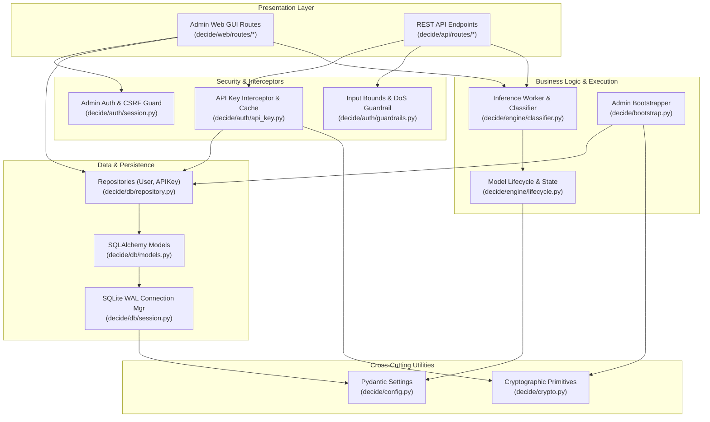

# LLD-01: System Architecture & Package Structure

## 1. Architectural Model

`decide` is organized using a layered, modular architecture with unidirectional dependency flows.

---

## 2. Directory & Module Roles

| Directory / File | Layer | Primary Role |
| :--- | :--- | :--- |
| `decide/config.py` | Config | Parses environment variables, provides global `Settings` object with validation. |
| `decide/crypto.py` | Core Utility | Cryptographic routines: Bcrypt hashing, SHA-256 digests, key generation, constant-time checks. |
| `decide/bootstrap.py` | Initialization | Runs on boot: provisions SQLite tables, seeds or resets admin credentials, logs to stdout. |
| `decide/db/session.py` | Persistence | SQLite engine configuration with WAL pragmas, session factories, and FastAPI dependencies. |
| `decide/db/models.py` | Persistence | SQLAlchemy declarative models: `User` and `APIKey` with foreign keys and indexes. |
| `decide/db/repository.py` | Persistence | Data access layer methods for user management, key creation, lookup, and revocation. |
| `decide/auth/api_key.py` | Security | Fast in-memory key cache and FastAPI dependency for validating `X-API-Key` headers. |
| `decide/auth/session.py` | Security | Cookie session serializer, admin authentication dependency, and CSRF token validation. |
| `decide/auth/guardrails.py`| Security | Pydantic payload models enforcing limits (8,000 chars text, 20 tasks, 50 labels). |
| `decide/engine/loader.py` | Inference | Loads `fastino/GLiNER2.5-Decide` via `AutoExtractor`, selects device (`cuda:0` / `cpu`). |
| `decide/engine/classifier.py` | Inference | Single-pass classification pipeline under `torch.inference_mode()`, latency timing. |
| `decide/engine/lifecycle.py` | Inference | FastAPI lifespan context manager, model pre-warming, and engine readiness state registry. |
| `decide/api/routes/health.py` | Presentation | Public `GET /health` probe returning engine status and device identifier. |
| `decide/api/routes/predict.py` | Presentation | Secured `POST /predict` endpoint, executes inference, triggers async telemetry. |
| `decide/web/routes/auth.py` | Presentation | Handles admin login forms, session cookie creation, and logout. |
| `decide/web/routes/dashboard.py`| Presentation | Handles `/admin` dashboard, HTMX key creation modal, and instant revocation. |
| `decide/web/routes/playground.py`| Presentation | Handles interactive model playground, form execution, and latency display. |

---

## 3. Dependency Guidelines & Constraints

1. **No Circular Dependencies:** Lower layers (`config`, `crypto`, `db`) must never import from upper layers (`api`, `web`, `engine`).
2. **Offline Assets:** The `web` layer bundles static CSS and JS locally in `decide/web/static/` — no outbound CDN calls are permitted.
3. **Single Process Model Worker:** To safeguard GPU VRAM, Uvicorn runs with `workers=1` by default. Concurrency is handled asynchronously by FastAPI event loops.
