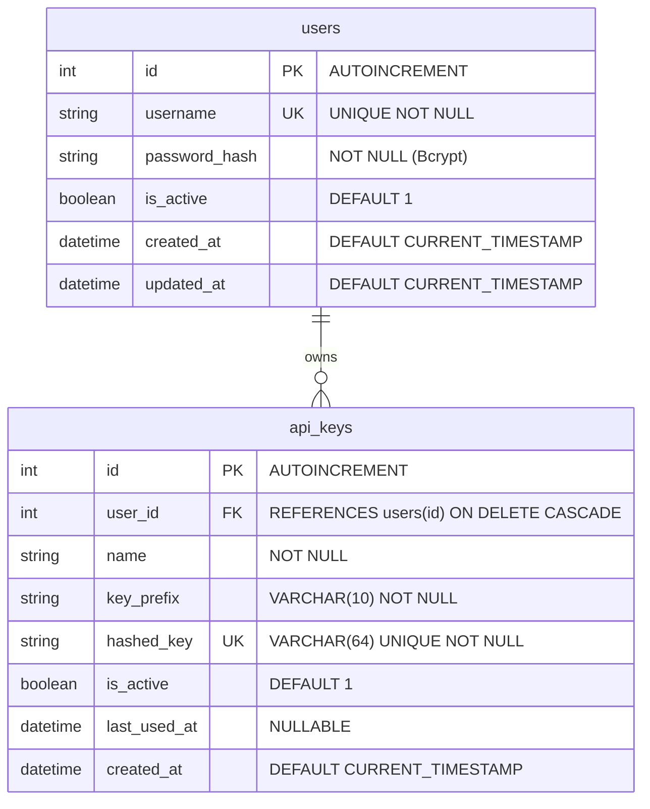

# LLD-02: Database & Persistence Layer

## 1. Overview & SQLite Configuration

`decide` utilizes an embedded SQLite database stored at `/data/decide.db` (configurable via `DATABASE_PATH`). To achieve high concurrent read performance alongside non-blocking telemetry writes, the database is configured in **Write-Ahead Logging (WAL)** mode.

### 1.1 Connection PRAGMA Tuning

Every connection established by SQLAlchemy executes the following PRAGMA statements:
```sql
PRAGMA journal_mode = WAL;
PRAGMA busy_timeout = 5000;
PRAGMA synchronous = NORMAL;
PRAGMA foreign_keys = ON;
```

- `journal_mode = WAL`: Allows concurrent readers while a background task writes `last_used_at` timestamps.
- `busy_timeout = 5000`: Waits up to 5 seconds if a transient write lock occurs, eliminating database locked errors.
- `synchronous = NORMAL`: Ensures integrity in WAL mode with reduced fsync overhead.
- `foreign_keys = ON`: Enforces cascading deletions when users are purged.

---

## 2. Relational Schema & DDL



### 2.1 Indexing Strategy
- `idx_api_keys_hashed_key`: Unique B-Tree index on `api_keys(hashed_key)`. Direct O(1) indexed lookup when checking keys during `POST /predict`.
- `idx_api_keys_is_active`: B-Tree index on `api_keys(is_active)`. Accelerates active key filtering.

---

## 3. SQLAlchemy 2.0 Class Definitions

### `decide/db/models.py`

```python
from datetime import datetime
from typing import List, Optional
from sqlalchemy import Column, Integer, String, Boolean, DateTime, ForeignKey, Index
from sqlalchemy.orm import declarative_base, relationship

Base = declarative_base()

class User(Base):
    __tablename__ = "users"

    id: int = Column(Integer, primary_key=True, autoincrement=True)
    username: str = Column(String, unique=True, nullable=False, index=True)
    password_hash: str = Column(String, nullable=False)
    is_active: bool = Column(Boolean, nullable=False, default=True)
    created_at: datetime = Column(DateTime, nullable=False, default=datetime.utcnow)
    updated_at: datetime = Column(DateTime, nullable=False, default=datetime.utcnow, onupdate=datetime.utcnow)

    api_keys: relationship = relationship(
        "APIKey",
        back_populates="user",
        cascade="all, delete-orphan",
        passive_deletes=True,
    )

class APIKey(Base):
    __tablename__ = "api_keys"

    id: int = Column(Integer, primary_key=True, autoincrement=True)
    user_id: int = Column(Integer, ForeignKey("users.id", ondelete="CASCADE"), nullable=False)
    name: str = Column(String, nullable=False)
    key_prefix: str = Column(String(10), nullable=False)
    hashed_key: str = Column(String(64), unique=True, nullable=False)
    is_active: bool = Column(Boolean, nullable=False, default=True)
    last_used_at: Optional[datetime] = Column(DateTime, nullable=True)
    created_at: datetime = Column(DateTime, nullable=False, default=datetime.utcnow)

    user: relationship = relationship("User", back_populates="api_keys")

    __table_args__ = (
        Index("idx_api_keys_hashed_key", "hashed_key"),
        Index("idx_api_keys_is_active", "is_active"),
    )
```

---

## 4. Repository Operations & Methods

### `decide/db/repository.py`

#### `UserRepository`
- `get_by_username(db: Session, username: str) -> Optional[User]`: Retrieves user by unique username.
- `get_by_id(db: Session, user_id: int) -> Optional[User]`: Retrieves user by primary key.
- `count(db: Session) -> int`: Returns total count of users (used by bootstrapper).
- `create(db: Session, username: str, password_hash: str) -> User`: Creates and commits a new user.
- `update_password(db: Session, user: User, password_hash: str) -> User`: Updates password hash and updates `updated_at`.

#### `APIKeyRepository`
- `get_by_hash(db: Session, hashed_key: str) -> Optional[APIKey]`: Indexed lookup using `idx_api_keys_hashed_key`.
- `list_all(db: Session) -> List[APIKey]`: Returns all keys sorted by `created_at DESC` for admin dashboard.
- `create(db: Session, user_id: int, name: str, key_prefix: str, hashed_key: str) -> APIKey`: Inserts a newly issued key record.
- `revoke(db: Session, key_id: int) -> Optional[APIKey]`: Sets `is_active = False` without deleting historical record.
- `update_last_used(db: Session, key_id: int, timestamp: Optional[datetime] = None) -> None`: Updates `last_used_at` timestamp.
