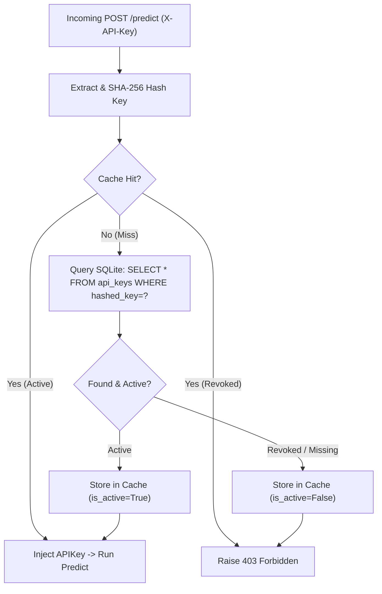

# LLD-03: Security & Authentication Subsystem

## 1. Cryptographic Primitives & Token Lifecycle

### 1.1 Password Hashing
- Algorithm: `bcrypt` with salt rounds = 12.
- Used exclusively for administrative credentials.
- Functions: `hash_password(plain_password: str) -> str`, `verify_password(plain: str, hashed: str) -> bool`.

### 1.2 API Key Token Generation & Prefix Extraction
- **Format:** `dec_<32_random_alphanumeric_characters>` (Length = 36).
- **RNG Source:** Python `secrets.token_urlsafe(24)` filtered to alphanumeric characters or `secrets.choice("abcdefghijklmnopqrstuvwxyzABCDEFGHIJKLMNOPQRSTUVWXYZ0123456789")`.
- **Prefix:** `raw_key[:10]` (e.g. `dec_9aBcDe`).
- **Digest:** SHA-256 hex digest (`hashlib.sha256(raw_key.encode()).hexdigest()`), length = 64.
- **Constant-Time Comparison:** `hmac.compare_digest(digest_a, digest_b)`.

---

## 2. In-Memory API Key Cache & < 1ms Auth Overhead

To meet the PRD KPI of **Auth Lookup Overhead < 1 ms**, `decide` maintains a thread-safe in-memory cache layer in `decide/auth/api_key.py`.



### Cache Invalidation
When an administrator revokes a key via the admin GUI (`POST /admin/keys/{id}/revoke`), `APIKeyCache.invalidate(hashed_key)` is called immediately, ensuring revoked keys are rejected on subsequent requests without waiting for a TTL expiry.

---

## 3. Automated Admin Seeding & Bootstrapper

Implemented in `decide/bootstrap.py`:
1. Check `UserRepository.count(db)`.
2. If `count == 0`:
   - If `settings.admin_password` is provided, hash with bcrypt and insert admin user.
   - If `settings.admin_password` is unset (`None`), generate a 24-character random password using `secrets.choice`, hash with bcrypt, insert admin user, and print the following box to `sys.stdout`:

```
================================================================================
                       DECIDE APPLIANCE BOOTSTRAP
================================================================================
 Administrator account created successfully:
 Username : admin
 Password : <auto_generated_24_char_password>

 IMPORTANT: Save these credentials immediately. They will not be shown again.
================================================================================
```

3. If users exist and `FORCE_ADMIN_RESET=true`:
   - Update admin password to `settings.admin_password` or auto-generate a new one and print it to stdout.

---

## 4. Admin Session & CSRF Security

1. **Session Cookie:**
   - Cookie Name: `decide_session`
   - Signed using `itsdangerous.URLSafeTimedSerializer(settings.secret_key)`.
   - Security parameters: `HttpOnly=True`, `SameSite="lax"`, `Secure=True` (configurable for TLS termination).
   - Expiration: 12 hours.
2. **CSRF Protection:**
   - A cryptographic CSRF token is attached to the session and injected into forms via hidden inputs (`csrf_token`) and headers (`X-CSRF-Token`).
   - All mutating requests (`POST /admin/keys`, `POST /admin/keys/{id}/revoke`, `POST /admin/playground/test`) validate the token before execution.

---

## 5. Denial of Service & Request Boundary Guardrails

Implemented in `decide/auth/guardrails.py`:
- `text`: Maximum 8,000 characters. Checked before tokenizer ingestion. Exceeding lengths return HTTP 422.
- `tasks`: Maximum 20 distinct task keys per request.
- `labels`: Maximum 50 candidate labels per task.
- Zero-length text or empty label arrays return HTTP 422.
