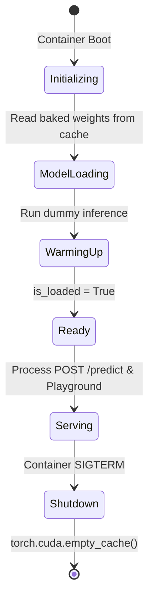

# LLD-04: Model Execution Engine

## 1. Overview & Dependencies

The inference subsystem hosts Fastino’s `GLiNER2.5-Decide` model, encapsulated in a single-process in-memory worker context per Uvicorn instance.

- **Framework:** PyTorch 2.x
- **Inference Library:** `gliner2` (`AutoExtractor`)
- **Model Checkpoint:** `fastino/GLiNER2.5-Decide`
- **Cache Location:** `/root/.cache/huggingface/` (baked into container layer during `docker build`)

---

## 2. Device Detection & Target Resolution

Implemented in `decide/engine/loader.py`:

```python
import torch
from typing import Literal

def resolve_device(configured: Literal["auto", "cpu", "cuda"]) -> torch.device:
    if configured == "auto":
        if torch.cuda.is_available():
            return torch.device("cuda:0")
        return torch.device("cpu")
    elif configured == "cuda":
        if not torch.cuda.is_available():
            raise RuntimeError("CUDA was requested via DEVICE=cuda, but no CUDA-enabled GPU was detected.")
        return torch.device("cuda:0")
    elif configured == "cpu":
        return torch.device("cpu")
    else:
        raise ValueError(f"Unknown device configuration: {configured}")
```

---

## 3. Model Loading & Offline Guarantee

The model is initialized with `local_files_only=True` to guarantee zero runtime network calls:

```python
from gliner2 import AutoExtractor
from pathlib import Path
import torch

def load_model(device: torch.device, cache_dir: Path) -> AutoExtractor:
    # offline model loading from pre-baked container cache
    extractor = AutoExtractor.from_pretrained(
        "fastino/GLiNER2.5-Decide",
        cache_dir=str(cache_dir),
        local_files_only=True
    )
    # Move model parameters to selected compute target
    if hasattr(extractor, "model"):
        extractor.model.to(device)
        extractor.model.eval()
    return extractor
```

---

## 4. Single-Pass Multi-Task Inference Pipeline

Implemented in `decide/engine/classifier.py`:

```python
import time
from typing import Dict, List, Any
import torch

class MultiTaskClassifier:
    def __init__(self, extractor: Any, device: torch.device):
        self.extractor = extractor
        self.device = device

    def predict(self, text: str, tasks: Dict[str, List[str]]) -> Dict[str, Any]:
        start = time.perf_counter()

        with torch.inference_mode():
            # GLiNER2.5 single-pass extraction across multiple schemas
            raw_output = self.extractor.extract(text, tasks)

            # Map raw output to normalized dictionary: {"intent": "...", "urgency": "..."}
            normalized_result: Dict[str, str] = {}
            for task_name, candidates in tasks.items():
                predicted_label = raw_output.get(task_name)
                if predicted_label:
                    normalized_result[task_name] = predicted_label
                else:
                    # Fallback or top candidate if ambiguous
                    normalized_result[task_name] = candidates[0] if candidates else "unknown"

        latency_ms = (time.perf_counter() - start) * 1000.0

        return {
            "result": normalized_result,
            "latency_ms": round(latency_ms, 2)
        }
```

---

## 5. Engine Lifecycle, Warmup & State Registry

Implemented in `decide/engine/lifecycle.py`:



- **Warmup Execution:** Before marking the engine ready, a dummy prediction (`text="warmup"`, `tasks={"intent": ["test"]}`) is evaluated to compile PyTorch kernels and eliminate cold-start lag.
- **Readiness State:** `EngineState.is_loaded` reports `True` only after the warmup cycle completes, which controls whether `/health` returns `200 OK` or `503 Service Unavailable`.
