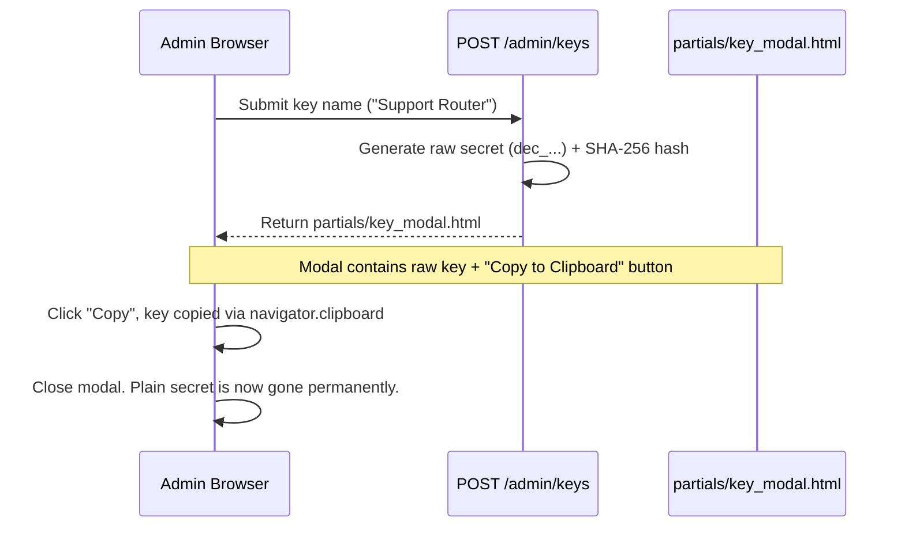

# LLD-06: Admin Web GUI Subsystem

## 1. Overview & Frontend Architecture

The administrative portal allows managing API keys, viewing audit telemetry, and testing models interactively.
- **Rendering:** Server-Side Jinja2 templates.
- **Interactivity:** HTMX (asynchronous HTML fragment swapping without full page reloads).
- **Styling:** Tailwind CSS (pre-compiled standalone stylesheet, bundled in `decide/web/static/css/tailwind.min.css`).
- **Dependencies:** Completely local — no runtime Node.js, npm, or CDN calls.

---

## 2. Page & Route Specifications

```
/admin
├── /login          [GET/POST] Form login, session cookie generation
├── /logout         [POST] Clears session cookie, redirects to login
├──                 [GET] Main dashboard: API key table, stats, create modal
├── /keys           [POST] HTMX: Creates key, returns one-time modal & appends row
├── /keys/{id}/revoke [POST] HTMX: Revokes key, swaps status badge in-place
└── /playground     [GET/POST] Interactive model inference testing interface
```

---

## 3. Key Management UI Workflows

### 3.1 One-Time Plain Secret Exposure Modal



### 3.2 Instant HTMX Revocation
Table rows in `partials/key_row.html` contain:
```html
<button hx-post="/admin/keys/{{ key.id }}/revoke"
        hx-target="#key-row-{{ key.id }}"
        hx-swap="outerHTML"
        class="text-red-600 hover:text-red-800">
    Revoke
</button>
```
On click:
- HTMX sends an async POST request.
- The server updates `is_active = False` in SQLite and invalidates the in-memory cache.
- The server returns updated HTML for that single `<tr>`, replacing the "Active" badge with "Revoked" and disabling the revoke button.

---

## 4. Interactive Playground (`/admin/playground`)

### Interface Layout
- **Text Input Box:** Multi-line text area pre-populated with PRD sample query.
- **Tasks Configuration:** JSON editor pre-populated with:
  ```json
  {
    "intent": ["refund", "replacement", "tracking", "general_inquiry"],
    "urgency": ["low", "normal", "critical"]
  }
  ```
- **Execution:** Triggered via HTMX:
  ```html
  <button hx-post="/admin/playground/test"
          hx-target="#playground-result"
          hx-indicator="#loading-spinner"
          class="bg-blue-600 hover:bg-blue-700 text-white font-medium px-4 py-2 rounded">
      Test Predict
  </button>
  ```
- **Result Panel:** Displays formatted JSON response and execution latency badge (e.g. `⚡ 22.4 ms`).
