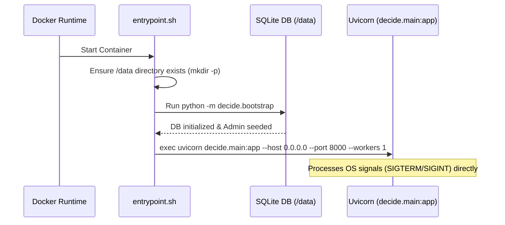

# LLD-07: Containerization & Runtime Environment

## 1. Overview & Image Layout

The container is built as a self-contained runtime appliance hosting Python 3.11, all required libraries, pre-baked Hugging Face model weights, and pre-compiled frontend assets.

---

## 2. Multi-Stage Dockerfile Architecture

```dockerfile
# syntax=docker/dockerfile:1.4
FROM python:3.11-slim as runtime

ENV PYTHONUNBUFFERED=1 \
    PYTHONDONTWRITEBYTECODE=1 \
    HF_HUB_OFFLINE=1 \
    PORT=8000 \
    WORKERS=1 \
    DATABASE_PATH=/data/decide.db

WORKDIR /app

# 1. Install system utilities
RUN apt-get update && apt-get install -y --no-install-recommends \
    curl \
    && rm -rf /var/lib/apt/lists/*

# 2. Install Python dependencies
COPY requirements.txt .
RUN pip install --no-cache-dir -r requirements.txt

# 3. Bake model weights during image build
# Temporarily enable network during this build step to fetch model weights
COPY scripts/bake_model.py ./scripts/
RUN HF_HUB_OFFLINE=0 python scripts/bake_model.py

# 4. Copy application source
COPY decide ./decide
COPY entrypoint.sh .
RUN chmod +x entrypoint.sh

# 5. Define persistent volume and port
VOLUME ["/data"]
EXPOSE 8000

# 6. Container healthcheck
HEALTHCHECK --interval=10s --timeout=5s --start-period=15s --retries=3 \
  CMD curl -f http://localhost:8000/health || exit 1

ENTRYPOINT ["./entrypoint.sh"]
```

---

## 3. Persistent Volume Layout (`/data`)

The `/data` volume houses:
- `decide.db`: SQLite database file.
- `decide.db-wal`: Write-Ahead Log journal.
- `decide.db-shm`: Shared memory index for WAL readers.

The directory is created and verified on container boot.

---

## 4. Entrypoint Process Lifecycle



### Signal Handling
Using `exec uvicorn ...` ensures Uvicorn runs as PID 1 inside the container, receiving `SIGTERM` signals directly from Docker for clean shutdowns and graceful resource releases.
