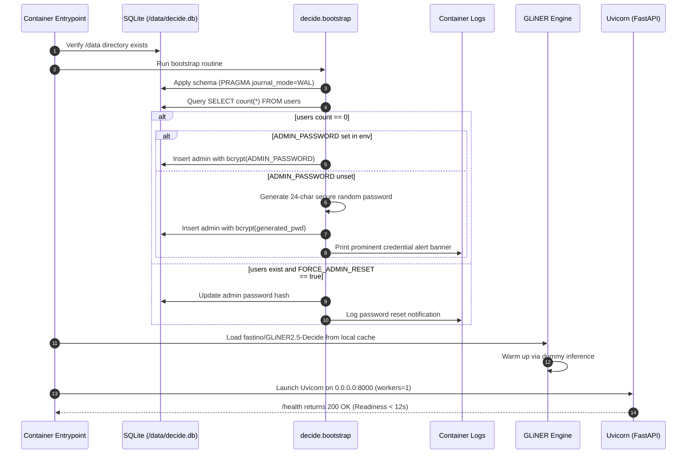
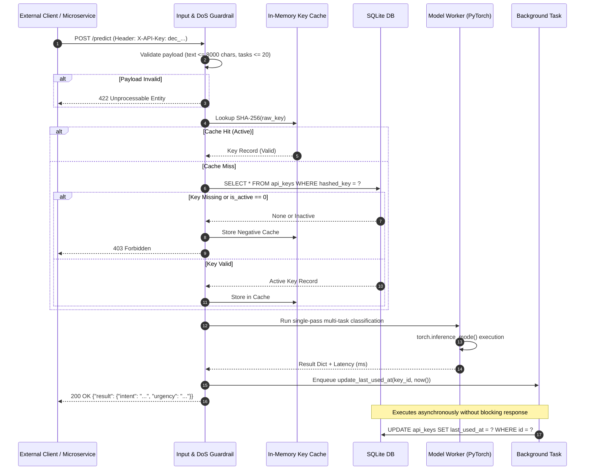
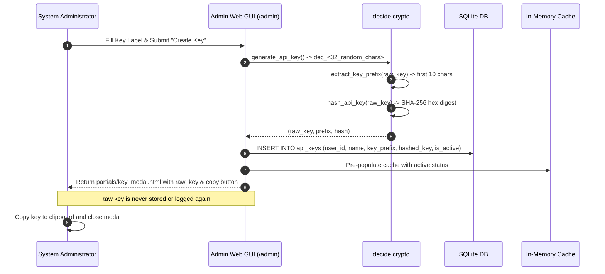

# Low-Level Design (LLD): `decide` Microservice

**Version:** 1.0 (Final)  
**System Target:** Self-hosted inference microservice for Fastino’s `GLiNER2.5-Decide` with embedded SQLite WAL key management and admin Web GUI  
**PRD Reference:** [PRD.md](file:///home/abhishek/decide/PRD.md)  
**Tasks Reference:** [tasks/index.md](file:///home/abhishek/decide/tasks/index.md)  

---

## 1. Executive Summary & Design Principles

`decide` is designed as a standalone, zero-dependency Docker appliance hosting `fastino/GLiNER2.5-Decide`. The low-level design is guided by four architectural pillars:

1. **Self-Sufficiency & Offline Guarantee:** All model weights, HTML templates, CSS styles, and JS libraries (HTMX) are bundled directly into the container image layer. Zero external CDN or network requests occur at runtime.
2. **Deterministic High Performance:** Single-pass multi-task classification executed in `torch.inference_mode()`, combined with an in-memory cached SHA-256 API key validator (< 1 ms auth lookup overhead) and asynchronous SQLite telemetry updates.
3. **Defense-in-Depth Security:** Constant-time hash verification (`hmac.compare_digest`), bcrypt password hashing, one-time raw secret exposure for API keys, strict payload size bounds (8,000 char max text, 20 max tasks), signed HTTP-only cookies, and CSRF protection.
4. **VRAM Concurrency Safety:** Single-process worker architecture (`workers=1` default) to prevent GPU memory thrashing and multi-process VRAM exhaustion while serving concurrent requests via FastAPI's asynchronous event loop.

---

## 2. Codebase Organization & Package Hierarchy

```
decide/
├── __init__.py                     # Package version and root exports
├── config.py                       # Pydantic Settings & environment variable configuration
├── crypto.py                       # Cryptographic primitives (bcrypt, SHA-256, tokens)
├── main.py                         # FastAPI application factory, lifespan, and router mounting
├── bootstrap.py                    # Container entrypoint bootstrapper (admin seeding, DB init)
│
├── db/                             # Persistence subsystem (SQLite WAL + SQLAlchemy 2.0)
│   ├── __init__.py
│   ├── session.py                  # Engine, WAL PRAGMA setup, sessionmaker, get_db dependency
│   ├── models.py                   # ORM schema models: User, APIKey
│   └── repository.py               # UserRepository and APIKeyRepository CRUD methods
│
├── auth/                           # Authentication, authorization, and guardrails
│   ├── __init__.py
│   ├── api_key.py                  # X-API-Key auth dependency, SHA-256 matching, in-memory cache
│   ├── session.py                  # Admin session cookie signing, CSRF guard, auth dependencies
│   └── guardrails.py               # Payload bounds validator (8000 chars, 20 tasks, 50 labels)
│
├── engine/                         # Model inference engine
│   ├── __init__.py
│   ├── loader.py                   # PyTorch device detection & gliner2 AutoExtractor loader
│   ├── classifier.py               # MultiTaskClassifier, single-pass inference, latency tracking
│   └── lifecycle.py                # EngineState singleton, FastAPI lifespan hook, warmup logic
│
├── api/                            # Public & secured REST API endpoints
│   ├── __init__.py
│   ├── middleware.py               # Latency header (X-Response-Time), security headers, exceptions
│   └── routes/
│       ├── __init__.py
│       ├── health.py               # GET /health probe
│       └── predict.py              # POST /predict inference route
│
└── web/                            # Administrative Web GUI subsystem
    ├── __init__.py
    ├── static/                     # Bundled local static assets (Zero CDN)
    │   ├── css/
    │   │   └── tailwind.min.css    # Pre-compiled Tailwind CSS
    │   └── js/
    │       └── htmx.min.js         # HTMX 1.9.x standalone bundle
    ├── templates/                  # Server-rendered Jinja2 templates
    │   ├── base.html               # Main layout (navigation, styling, CSRF tokens)
    │   ├── login.html              # Admin authentication form
    │   ├── dashboard.html          # API Key management dashboard
    │   ├── playground.html         # Interactive model testing sandbox
    │   └── partials/
    │       ├── key_row.html        # HTMX partial for API key table row
    │       ├── key_modal.html      # HTMX modal displaying newly issued raw key
    │       └── playground_result.html # HTMX partial with prediction JSON & latency pill
    └── routes/
        ├── __init__.py
        ├── auth.py                 # GET/POST /admin/login, POST /admin/logout
        ├── dashboard.py            # GET /admin, POST /admin/keys, POST /admin/keys/{id}/revoke
        └── playground.py           # GET /admin/playground, POST /admin/playground/test
```

---

## 3. Detailed Component LLD Documents

For detailed technical designs of each specific subsystem, refer to the following documents:

| Component | LLD Document | Key Technical Responsibilities |
| :--- | :--- | :--- |
| **Persistence & Models** | [02-database-and-models.md](file:///home/abhishek/decide/lld/02-database-and-models.md) | SQLite WAL mode tuning, ORM models (`User`, `APIKey`), repository methods, cascade deletes. |
| **Security & Authentication** | [03-security-and-auth.md](file:///home/abhishek/decide/lld/03-security-and-auth.md) | In-memory API key cache (< 1ms overhead), admin bootstrap, session cookies, CSRF, and DoS limits. |
| **Model Inference Engine** | [04-model-engine.md](file:///home/abhishek/decide/lld/04-model-engine.md) | `AutoExtractor` loader, offline weights caching, device auto-resolution, `torch.inference_mode()`. |
| **REST API & Middleware** | [05-api-and-middleware.md](file:///home/abhishek/decide/lld/05-api-and-middleware.md) | `GET /health`, `POST /predict`, Pydantic input/output schemas, error codes (401/403/422/500). |
| **Admin Web GUI Engine** | [06-admin-gui.md](file:///home/abhishek/decide/lld/06-admin-gui.md) | Jinja2 templates, HTMX reactive key issuance/revocation, playground execution, local Tailwind styling. |
| **Container & Runtime** | [07-container-and-runtime.md](file:///home/abhishek/decide/lld/07-container-and-runtime.md) | Multi-stage Dockerfile, build-time weight baking, `/data` volume layout, entrypoint execution. |

---

## 4. End-to-End System Workflows & Sequence Diagrams

### 4.1 Container Startup & Automated Admin Bootstrap Flow

When the Docker container starts, `entrypoint.sh` executes the bootstrap sequence before opening the HTTP port.



---

### 4.2 Secured Inference Workflow (`POST /predict`)

External clients transmit classification requests with the `X-API-Key` header. The request path guarantees constant-time validation and asynchronous telemetry logging.



---

### 4.3 Key Creation & One-Time Display Lifecycle

API keys are created exclusively via the admin dashboard. The plain secret is returned once and never persisted.



---

## 5. Security & Threat Model

| Threat Vector | Mitigation Strategy | LLD Implementation |
| :--- | :--- | :--- |
| **Timing Attacks on API Keys** | Avoid early-exit string comparisons. SHA-256 hashes compared with constant-time equality. | `hmac.compare_digest(hash1, hash2)` in [crypto.py](file:///home/abhishek/decide/lld/03-security-and-auth.md). |
| **Plaintext Credential Theft** | Plaintext API keys and user passwords never saved to disk or serialized into logs. | Passwords hashed with `bcrypt`; keys stored as 64-char SHA-256 hex digests. |
| **Denial of Service (Memory Exhaustion)** | Strict request body validation. Text length capped at 8,000 characters; tasks capped at 20 with max 50 labels each. | Custom Pydantic validator `PredictInputSchema` in [guardrails.py](file:///home/abhishek/decide/lld/03-security-and-auth.md). |
| **GPU Out-Of-Memory (VRAM Race)** | Concurrency safety when handling large PyTorch tensors. | Default `WORKERS=1` in Uvicorn; batching disabled on single-pass endpoint. |
| **Session Hijacking & CSRF** | Cookie spoofing and cross-site form submission on admin actions. | Signed session cookies (`HttpOnly`, `SameSite=Lax`); CSRF tokens required on all POST requests. |
| **Supply Chain / External Disruption** | External dependencies or Hugging Face hub downtime during runtime. | Build-time baked weights and local Tailwind/HTMX assets; container enforces `HF_HUB_OFFLINE=1`. |

---

## 6. Performance & Scalability Targets

| Metric | PRD Target | Architectural Implementation |
| :--- | :--- | :--- |
| **CPU P95 Latency** | < 150 ms | Single-pass classification using `gliner2.AutoExtractor` under `torch.inference_mode()`. |
| **GPU P95 Latency** | < 35 ms | CUDA-accelerated tensor kernels on NVIDIA T4/L4; zero-copy inference pipeline. |
| **Auth Lookup Overhead** | < 1 ms | Local dictionary/LRU cache matching SHA-256 hashes before falling back to indexed SQLite lookup. |
| **Container Readiness** | < 12 seconds | Model weights baked into `/root/.cache/huggingface/`; startup lifecycle runs dummy warmup inference immediately. |
| **Availability** | 99.9% | SQLite WAL mode (`PRAGMA journal_mode=WAL;`) with 5-second `busy_timeout` preventing lock contention. |
