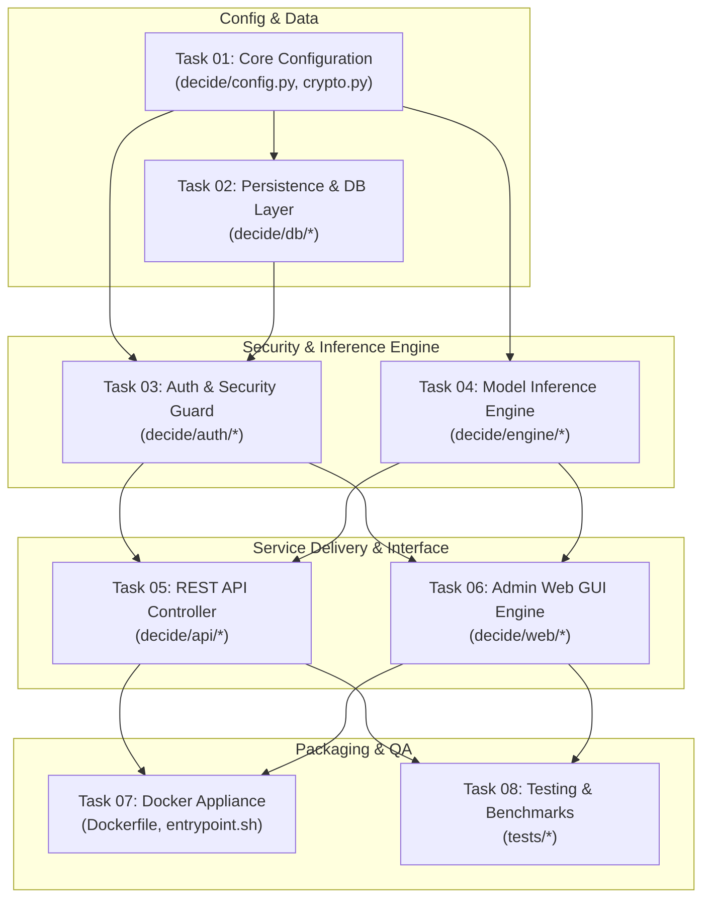

# Master Tasks Index & Architectural Roadmap: `decide`

This document outlines the complete implementation roadmap and module-by-module task breakdown required to build **`decide`**, a self-hosted inference microservice for Fastino’s `GLiNER2.5-Decide` with integrated SQLite key management, admin Web GUI, and Docker containerization, as specified in [PRD.md](file:///home/abhishek/decide/PRD.md).

---

## 1. Architectural Module Overview

The system is decomposed into 8 core functional modules. Each module corresponds to a dedicated task directory containing granular subtasks representing code submodules.

---

## 2. Master Task List

| Task ID | Module / Subsystem | Directory | Subtasks / Submodules | Target Code Paths | Status |
| :--- | :--- | :--- | :--- | :--- | :--- |
| **TASK-01** | Core Configuration & Cryptographic Utilities | [01-core-configuration](file:///home/abhishek/decide/tasks/01-core-configuration/index.md) | 2 Subtasks | `decide/config.py` `decide/crypto.py` | `Completed` |
| **TASK-02** | Database Layer & Persistence | [02-database-and-persistence](file:///home/abhishek/decide/tasks/02-database-and-persistence/index.md) | 3 Subtasks | `decide/db/session.py` `decide/db/models.py` `decide/db/repository.py` | `Completed` |
| **TASK-03** | Authentication & Security Guard | [03-authentication-and-security](file:///home/abhishek/decide/tasks/03-authentication-and-security/index.md) | 4 Subtasks | `decide/auth/bootstrap.py` `decide/auth/api_key.py` `decide/auth/session.py` `decide/auth/guardrails.py` | `Completed` |
| **TASK-04** | Model Execution Engine | [04-model-inference-engine](file:///home/abhishek/decide/tasks/04-model-inference-engine/index.md) | 3 Subtasks | `decide/engine/loader.py` `decide/engine/classifier.py` `decide/engine/lifecycle.py` | `Completed` |
| **TASK-05** | REST API Endpoints | [05-rest-api-controller](file:///home/abhishek/decide/tasks/05-rest-api-controller/index.md) | 3 Subtasks | `decide/api/routes/health.py` `decide/api/routes/predict.py` `decide/api/middleware.py` | `Completed` |
| **TASK-06** | Admin Web GUI Portal | [06-admin-web-gui](file:///home/abhishek/decide/tasks/06-admin-web-gui/index.md) | 4 Subtasks | `decide/web/templates/*` `decide/web/static/*` `decide/web/routes/*` | `Completed` |
| **TASK-07** | Containerization & Deployment | [07-docker-and-deployment](file:///home/abhishek/decide/tasks/07-docker-and-deployment/index.md) | 3 Subtasks | `Dockerfile` `entrypoint.sh` `docker-compose.yml` | `Completed` |
| **TASK-08** | Testing & Performance Benchmarks | [08-testing-and-benchmarks](file:///home/abhishek/decide/tasks/08-testing-and-benchmarks/index.md) | 3 Subtasks | `tests/unit/*` `tests/integration/*` `tests/benchmarks/*` | `Completed` |

---

## 3. Detailed Module & Subtask Roadmap

### [TASK-01: Core Configuration & Cryptographic Utilities](file:///home/abhishek/decide/tasks/01-core-configuration/index.md)
*Focus: Environment settings parsing, default fallbacks, runtime validation, and cryptographic routines.*
- [01-environment-and-settings.md](file:///home/abhishek/decide/tasks/01-core-configuration/01-environment-and-settings.md): Pydantic Settings management covering all PRD §8 environment variables, path resolutions, and validation constraints.
- [02-cryptographic-primitives.md](file:///home/abhishek/decide/tasks/01-core-configuration/02-cryptographic-primitives.md): Bcrypt hashing, SHA-256 digest computation, constant-time comparisons (`hmac.compare_digest`), secure password generation, and raw key formatting (`dec_<32_chars>`).

### [TASK-02: Database Layer & Persistence](file:///home/abhishek/decide/tasks/02-database-and-persistence/index.md)
*Focus: Embedded SQLite engine, WAL mode, SQLAlchemy 2.0 / SQLModel ORM models, indexes, and repositories.*
- [01-sqlite-engine-and-wal.md](file:///home/abhishek/decide/tasks/02-database-and-persistence/01-sqlite-engine-and-wal.md): SQLite connection lifecycle, WAL pragma setup (`PRAGMA journal_mode=WAL;`), busy timeout handling, and session factories.
- [02-orm-models-and-indexes.md](file:///home/abhishek/decide/tasks/02-database-and-persistence/02-orm-models-and-indexes.md): Schema declarations for `users` and `api_keys` with foreign keys, indexes (`idx_api_keys_hashed_key`, `idx_api_keys_is_active`), and timestamps.
- [03-repository-and-queries.md](file:///home/abhishek/decide/tasks/02-database-and-persistence/03-repository-and-queries.md): Data access layer for user authentication, API key registration, prefix slicing (10 chars), revocation, and usage telemetry.

### [TASK-03: Authentication & Security Guard](file:///home/abhishek/decide/tasks/03-authentication-and-security/index.md)
*Focus: Automated admin bootstrap, API key authentication interceptor with caching, session management, and anti-DoS guardrails.*
- [01-admin-seeding-and-bootstrap.md](file:///home/abhishek/decide/tasks/03-authentication-and-security/01-admin-seeding-and-bootstrap.md): Zero-touch admin bootstrap on boot, random password generation when unset, stdout notification, and `FORCE_ADMIN_RESET` handling.
- [02-api-key-auth-and-caching.md](file:///home/abhishek/decide/tasks/03-authentication-and-security/02-api-key-auth-and-caching.md): FastAPI dependency for `X-API-Key`, SHA-256 hashing, sub-millisecond in-memory cache, and non-blocking background telemetry update (`last_used_at`).
- [03-session-management-and-csrf.md](file:///home/abhishek/decide/tasks/03-authentication-and-security/03-session-management-and-csrf.md): Admin cookie session engine (`HttpOnly`, `SameSite=Lax`, `Secure`), signed token serialization, and CSRF protection for mutating routes.
- [04-dos-and-input-guardrails.md](file:///home/abhishek/decide/tasks/03-authentication-and-security/04-dos-and-input-guardrails.md): Request boundary limits: 8,000 char maximum text, 20 max tasks, 50 max labels per task, and timing-attack-resistant comparisons.

### [TASK-04: Model Execution Engine](file:///home/abhishek/decide/tasks/04-model-inference-engine/index.md)
*Focus: Integration with `fastino/GLiNER2.5-Decide`, PyTorch device selection, inference worker, and lifecycle management.*
- [01-model-loader-and-device-detection.md](file:///home/abhishek/decide/tasks/04-model-inference-engine/01-model-loader-and-device-detection.md): `gliner2` `AutoExtractor` loading, offline local cache resolution, and device selection (`auto`, `cuda`, `cpu`).
- [02-multi-task-inference-pipeline.md](file:///home/abhishek/decide/tasks/04-model-inference-engine/02-multi-task-inference-pipeline.md): Single-pass classification pipeline under `torch.inference_mode()`, JSON schema conversion, latency measurement, and error handling.
- [03-engine-lifecycle-and-warmup.md](file:///home/abhishek/decide/tasks/04-model-inference-engine/03-engine-lifecycle-and-warmup.md): FastAPI lifespan hook for pre-warming model on boot, readiness flag coordination, and graceful cleanup.

### [TASK-05: REST API Controller](file:///home/abhishek/decide/tasks/05-rest-api-controller/index.md)
*Focus: Production FastAPI endpoints, request/response serialization, error mapping, and middleware.*
- [01-health-probe-endpoint.md](file:///home/abhishek/decide/tasks/05-rest-api-controller/01-health-probe-endpoint.md): Public `GET /health` probe returning status, readiness, and active device (`cuda:0` / `cpu`).
- [02-predict-endpoint.md](file:///home/abhishek/decide/tasks/05-rest-api-controller/02-predict-endpoint.md): Secured `POST /predict` endpoint, Pydantic schemas, 401/403/422/500 error contracts, and background task scheduling.
- [03-middleware-and-error-handling.md](file:///home/abhishek/decide/tasks/05-rest-api-controller/03-middleware-and-error-handling.md): Global exception handlers, latency logging middleware, and structured JSON error responses.

### [TASK-06: Admin Web GUI Portal](file:///home/abhishek/decide/tasks/06-admin-web-gui/index.md)
*Focus: Server-rendered Jinja2 interface with HTMX, Tailwind CSS, key management, and live model testing playground.*
- [01-template-engine-and-local-assets.md](file:///home/abhishek/decide/tasks/06-admin-web-gui/01-template-engine-and-local-assets.md): Jinja2 environment setup, dark/light theme layout, bundled local Tailwind CSS and HTMX scripts (zero external CDN or Node.js runtime).
- [02-admin-auth-and-login-routes.md](file:///home/abhishek/decide/tasks/06-admin-web-gui/02-admin-auth-and-login-routes.md): `GET /admin/login`, `POST /admin/login`, `POST /admin/logout`, session authentication guard, and flash messages.
- [03-dashboard-and-key-management-htmx.md](file:///home/abhishek/decide/tasks/06-admin-web-gui/03-dashboard-and-key-management-htmx.md): Admin dashboard (`GET /admin`), key list table, instant HTMX revocation, and one-time key generation modal with clipboard utility.
- [04-interactive-playground.md](file:///home/abhishek/decide/tasks/06-admin-web-gui/04-interactive-playground.md): Live interactive playground (`/admin/playground`) with text input, JSON task/labels editor, HTMX execution, and latency display.

### [TASK-07: Containerization & Deployment Appliance](file:///home/abhishek/decide/tasks/07-docker-and-deployment/index.md)
*Focus: Standalone Docker image, pre-baked model weights, persistent volume handling, and zero-network runtime operation.*
- [01-dockerfile-build-time-baking.md](file:///home/abhishek/decide/tasks/07-docker-and-deployment/01-dockerfile-build-time-baking.md): Multi-stage Dockerfile baking `fastino/GLiNER2.5-Decide` weights into the image layer during `docker build`.
- [02-container-entrypoint-and-volumes.md](file:///home/abhishek/decide/tasks/07-docker-and-deployment/02-container-entrypoint-and-volumes.md): `entrypoint.sh` for `/data` directory setup, DB schema initialization, admin bootstrapper, and Uvicorn process supervision (1 worker).
- [03-docker-compose-and-offline-verification.md](file:///home/abhishek/decide/tasks/07-docker-and-deployment/03-docker-compose-and-offline-verification.md): `docker-compose.yml` recipe, container healthchecks, volume mounts, and offline boot verification test.

### [TASK-08: Testing, Quality Assurance & Benchmarks](file:///home/abhishek/decide/tasks/08-testing-and-benchmarks/index.md)
*Focus: Automated test suites, integration test suite, and KPI verification.*
- [01-unit-test-suite.md](file:///home/abhishek/decide/tasks/08-testing-and-benchmarks/01-unit-test-suite.md): Unit tests for crypto functions, token generator, prefix cutter, repository methods, and input validation schemas.
- [02-integration-test-suite.md](file:///home/abhishek/decide/tasks/08-testing-and-benchmarks/02-integration-test-suite.md): Integration tests for `/health`, `/predict` auth permutations, admin login/logout, key creation/revocation, and playground.
- [03-kpi-performance-benchmarks.md](file:///home/abhishek/decide/tasks/08-testing-and-benchmarks/03-kpi-performance-benchmarks.md): Benchmark harness validating KPI requirements: CPU P95 < 150ms, GPU P95 < 35ms, Auth lookup < 1ms, and Startup < 12 seconds.

---

## 4. PRD Requirements Traceability Matrix

| PRD Section | PRD Requirement Description | Implementing Task & Subtasks |
| :--- | :--- | :--- |
| **§1, §2.1** | Turnkey container, embedded DB, baked model weights | `TASK-07` ([01](file:///home/abhishek/decide/tasks/07-docker-and-deployment/01-dockerfile-build-time-baking.md), [02](file:///home/abhishek/decide/tasks/07-docker-and-deployment/02-container-entrypoint-and-volumes.md)) |
| **§2.2** | KPIs: Latency (CPU < 150ms, GPU < 35ms), Auth < 1ms, Boot < 12s | `TASK-08` ([03](file:///home/abhishek/decide/tasks/08-testing-and-benchmarks/03-kpi-performance-benchmarks.md)), `TASK-03` ([02](file:///home/abhishek/decide/tasks/03-authentication-and-security/02-api-key-auth-and-caching.md)), `TASK-04` ([02](file:///home/abhishek/decide/tasks/04-model-inference-engine/02-multi-task-inference-pipeline.md)) |
| **§3, §4** | Tech Stack: FastAPI, PyTorch, gliner2, SQLite WAL, Jinja2+HTMX | `TASK-01` through `TASK-06` |
| **§5.1** | `users` table schema (id, username, password_hash, is_active, timestamps) | `TASK-02` ([02](file:///home/abhishek/decide/tasks/02-database-and-persistence/02-orm-models-and-indexes.md)) |
| **§5.2** | `api_keys` table schema & indexes (`hashed_key`, `is_active`) | `TASK-02` ([02](file:///home/abhishek/decide/tasks/02-database-and-persistence/02-orm-models-and-indexes.md)) |
| **§6.1** | Container initialization & automated admin seeding | `TASK-03` ([01](file:///home/abhishek/decide/tasks/03-authentication-and-security/01-admin-seeding-and-bootstrap.md)), `TASK-07` ([02](file:///home/abhishek/decide/tasks/07-docker-and-deployment/02-container-entrypoint-and-volumes.md)) |
| **§6.2** | API Key format `dec_<32_chars>`, prefix extraction, single plain copy | `TASK-01` ([02](file:///home/abhishek/decide/tasks/01-core-configuration/02-cryptographic-primitives.md)), `TASK-02` ([03](file:///home/abhishek/decide/tasks/02-database-and-persistence/03-repository-and-queries.md)), `TASK-06` ([03](file:///home/abhishek/decide/tasks/06-admin-web-gui/03-dashboard-and-key-management-htmx.md)) |
| **§6.3** | Admin Web Portal (`/admin`), login, key table, revocation, playground | `TASK-06` ([01](file:///home/abhishek/decide/tasks/06-admin-web-gui/01-template-engine-and-local-assets.md) - [04](file:///home/abhishek/decide/tasks/06-admin-web-gui/04-interactive-playground.md)) |
| **§7.1** | `GET /health` public endpoint (status, model_loaded, device) | `TASK-05` ([01](file:///home/abhishek/decide/tasks/05-rest-api-controller/01-health-probe-endpoint.md)) |
| **§7.2** | `POST /predict` (X-API-Key, background `last_used_at`, 401/403/422/500) | `TASK-05` ([02](file:///home/abhishek/decide/tasks/05-rest-api-controller/02-predict-endpoint.md)), `TASK-03` ([02](file:///home/abhishek/decide/tasks/03-authentication-and-security/02-api-key-auth-and-caching.md)) |
| **§8** | Environment variables & config defaults | `TASK-01` ([01](file:///home/abhishek/decide/tasks/01-core-configuration/01-environment-and-settings.md)) |
| **§9** | Persistent volume `/data`, build-time model baking, offline operation | `TASK-07` ([01](file:///home/abhishek/decide/tasks/07-docker-and-deployment/01-dockerfile-build-time-baking.md), [02](file:///home/abhishek/decide/tasks/07-docker-and-deployment/02-container-entrypoint-and-volumes.md)) |
| **§10** | Timing attack protection, DoS text/task caps, session cookie security | `TASK-01` ([02](file:///home/abhishek/decide/tasks/01-core-configuration/02-cryptographic-primitives.md)), `TASK-03` ([03](file:///home/abhishek/decide/tasks/03-authentication-and-security/03-session-management-and-csrf.md), [04](file:///home/abhishek/decide/tasks/03-authentication-and-security/04-dos-and-input-guardrails.md)) |

---

## 5. Recommended Execution Flow

To build `decide` incrementally with maximum testability, follow this task sequence:

1. **Step 1:** Implement [TASK-01](file:///home/abhishek/decide/tasks/01-core-configuration/index.md) (Configuration & Cryptography).
2. **Step 2:** Implement [TASK-02](file:///home/abhishek/decide/tasks/02-database-and-persistence/index.md) (SQLite, Models, Repositories).
3. **Step 3:** Implement [TASK-03](file:///home/abhishek/decide/tasks/03-authentication-and-security/index.md) (Bootstrap & Auth Guards).
4. **Step 4:** Implement [TASK-04](file:///home/abhishek/decide/tasks/04-model-inference-engine/index.md) (Model Engine & Classifier).
5. **Step 5:** Implement [TASK-05](file:///home/abhishek/decide/tasks/05-rest-api-controller/index.md) (REST API & `/predict`).
6. **Step 6:** Implement [TASK-06](file:///home/abhishek/decide/tasks/06-admin-web-gui/index.md) (Admin Portal & Playground).
7. **Step 7:** Implement [TASK-08](file:///home/abhishek/decide/tasks/08-testing-and-benchmarks/index.md) (Unit & Integration Tests).
8. **Step 8:** Implement [TASK-07](file:///home/abhishek/decide/tasks/07-docker-and-deployment/index.md) (Docker Bake & Offline Deployment).
